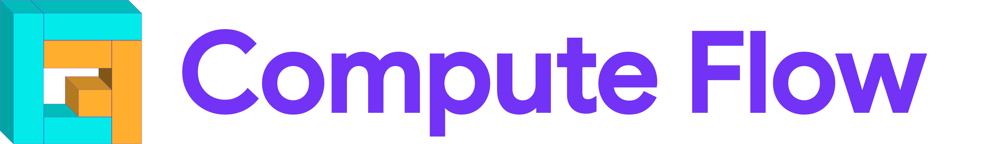

<!--
    SPDX-FileCopyrightText: Copyright 2025-2026 Arm Limited and/or its affiliates <open-source-office@arm.com>

    SPDX-License-Identifier: Apache-2.0
-->

<div align="center">
  
</div>

# Compute Flow

Compute Flow is an SDK for building AI and GenAI applications from reusable building blocks called
**bricks**.

Compute Flow brings together inference runtimes such as LiteRT, ExecuTorch, ONNX Runtime, and
llama.cpp so new bricks can be created without depending directly on each runtime API. It is
designed for Arm® edge AI inference across platforms, including Android™, Linux®, and macOS®
targets. It does not support microcontrollers.

## What can you do with Compute Flow?

Compute Flow helps you build sophisticated on-device AI applications by:

1. **Discovering, installing, and testing bricks**

   Use Brick Manager to find, install, and try ready-to-use AI bricks directly from your terminal.
   Add speech recognition, language models, text-to-speech, object detection, and more in just a few
   commands.

2. **Building sophisticated AI pipelines**

   Combine multiple bricks to create complete AI experiences. For example, you can build a local
   voice assistant by connecting a speech-to-text brick, a language model, and a text-to-speech
   brick.

3. **Creating reusable bricks**

   Build new bricks with models from different inference runtimes, and make them easy for the
   community to discover and reuse.

## Getting started

Use `uv` to create the Python environment used by the Compute Flow tools:

```bash
uv sync
source .venv/bin/activate
```

If you do not have `uv` installed, follow the
[installation guide](https://docs.astral.sh/uv/getting-started/installation/#pypi).

Check the local environment before installing or building bricks:

```bash
compute-flow check
```

If `compute-flow check` reports missing system dependencies, install them using the suggested action
and run the command again.

## Using bricks

The Compute Flow brick manager discovers bricks, installs the brick inference code, installs model
packages, and builds Compute Flow for the selected target. A typical native workflow is:

1. Update the local brick registry cache.
2. Install the brick and one of its models.
3. Build Compute Flow for the target platform.
4. Run the Python or C++ CLI example.

This example installs the Qwen3-TTS text-to-speech (TTS) brick and runs the native CLI examples.

```bash
compute-flow update
compute-flow model install tts:qwen3-tts qwen3-tts-custom-voice
compute-flow build native
```

### Shell completion

Shell completion works with the Brick Manager and the CLI examples after activating `.venv`:


- The Compute Flow Brick Manager completes commands, brick types, brick names, and models.
- The Python and C++ CLI examples complete installed `@manifest/...` and `@sample/...` selectors.

Run the Python CLI example with completion support:

```bash
python -m cli_examples.tts_cli \
  -m @manifest/qwen3-tts/qwen3-tts-custom-voice/qwen3_tts_custom_voice_en_manifest.json \
  -p "Hello, I am Aiden, your personal AI assistant. How can I help?" \
  -t 1
```

Or run the C++ CLI example with the same arguments:

```bash
./build_native/tts_cli \
  -m @manifest/qwen3-tts/qwen3-tts-custom-voice/qwen3_tts_custom_voice_en_manifest.json \
  -p "Hello, I am Aiden, your personal AI assistant. How can I help?" \
  -t 1
```

`@manifest` selects a manifest from an installed model package.

For a full native and Android™ walkthrough, see the
[getting started guide](docs/guides/getting_started.md).

### Supporting material

#### Guides

| Document                                                                  | Description                                            |
| ------------------------------------------------------------------------- | ------------------------------------------------------ |
| [**Getting started**](docs/guides/getting_started.md)                     | Build and run a brick on native and Android™ targets   |
| [**Build from source**](docs/guides/build_from_source.md)                 | Build dependencies without Conan binaries              |
| [**Combining bricks**](docs/guides/how_to_combine_bricks.md)              | Compose multiple bricks into an application pipeline   |
| [**Streamline capture**](docs/guides/how_to_capture_streamline_traces.md) | Capture timeline traces on Linux® and Android™ targets |
| [**Updating config**](docs/guides/how_to_update_config.md)                | Change runtime config values without reloading models  |

## Support

For help or feedback, please reach out via the project’s issue tracker or contact the maintainers
directly.

## Contributing

Compute Flow is evolving rapidly, so contributions to the `compute_flow` core are not currently
accepted. Ideas, feature requests, issue reports, and other feedback are welcome. See the
[contribution guidelines](CONTRIBUTING.md) for details.

## Authors

- **Gian Marco Iodice** (*gianmarco.iodice@arm.com*), Distinguished Engineer (CE-ML), Cambridge

- **Jakub Sujak** (*jakub.sujak@arm.com*), Senior Software Engineer (CE-ML), Cambridge

- **Yunus Kalkan** (*yunus.kalkan@arm.com*), Senior Software Engineer (STE), Cambridge

## Acknowledgments

We gratefully acknowledge (in alphabetical order) **Adnan AlSinan**, **Aude Vuilliomenet**,
**Charlotte Chen**, **Evie Wright**, **Marlon Jacobs**, **Maurice De Vries**, and **Kshitij
Sisodia** for their contributions, support, and valuable feedback on this project.

## Trademarks

See the [trademark reference](TRADEMARKS/README.md) for the canonical body forms, legal notices, and
usage rules for names used throughout the project.

## License

Compute Flow is licensed under the [Apache License 2.0](LICENSES/Apache-2.0.txt).

Third-party components remain subject to their respective licenses. See
[third-party notices](THIRD_PARTY_NOTICES.md) for the direct dependency inventory.

## Citation

If you use this project in your work, please cite it as:

```bibtex
@software{compute-flow,
  author  = {Iodice, Gian Marco and Sujak, Jakub and Kalkan, Yunus},
  title   = {compute-flow: a cross-platform SDK to streamline the creation of AI applications at the Edge},
  url     = {https://github.com/ARM-software/ComputeFlow},
  year    = {2026},
  organization = {Arm},
  address = {Cambridge, United Kingdom},
}
```

## Project Status

⚠️ This project is currently a prototype. Development is very active, but APIs and functionality may
change. Ideas, issue reports, and feedback are highly encouraged!
