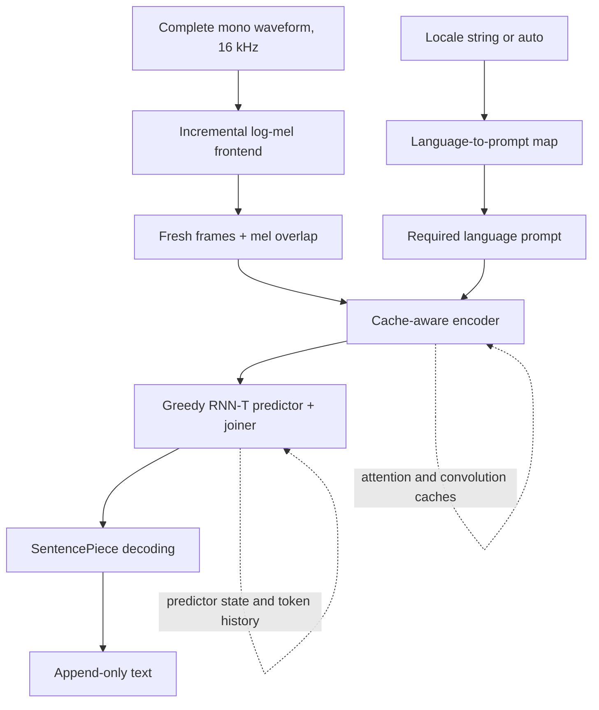

<!--
SPDX-FileCopyrightText: Copyright 2026 Arm Limited and/or its affiliates <open-source-office@arm.com>

SPDX-License-Identifier: Apache-2.0
-->

# Nemotron ASR architecture

`NemotronASR` implements the shared `stt.v1` contract defined in `brick_apis/stt.v1.json` in the
Compute Flow checkout. Its tensor wiring, frontend constants and language selection come from the
manifest. A language map and encoder prompt input are required. See [configuration](../README.md).
The shared `docs/design/brick_runtime_interface_v1.md` in that checkout owns the generic lifecycle;
this guide describes Nemotron-specific behaviour.

## Inference flow

The frontend computes log-mel features from waveform samples. Each encoder call consumes a chunk
with retained mel overlap and separate learned attention/convolution caches. The registered package
uses ExecuTorch for the encoder, predictor and joiner; the brick uses the Runner API rather than
calling their runtime directly.

For each valid encoded frame, the joiner combines the encoder output with the predictor output. A
nonblank token advances the predictor; a blank advances to the next encoded frame. The
`max_symbols_per_frame` bound raises an error if decoding cannot reach a blank within the cap,
rather than returning silently truncated text.

## Streaming semantics and state

Streaming here means **internal chunk processing with incremental text output**, not a live
microphone-buffer API. Supply the same complete, immutable waveform on successive `run()` calls
until generation completes. One instance owns one stream and must not be called concurrently.

Each call processes at most one encoder chunk, padding a short final chunk and decoding only valid
output frames. Encoder caches, predictor state and token history persist across calls. Reset before
the next utterance, including after an inference error; partially advanced state is not rolled back.

The frontend computes features as needed instead of retaining a full-utterance mel tensor. The
application retains the input waveform, while token history and transcript storage grow with the
utterance. Decoding the token history yields newly stable text: an unfinished trailing word is
withheld until whitespace or completion. Languages without spaces may therefore return most text at
completion. Model-emitted language tags remain in the output.

Output text is brick-owned and may be empty on a call. Copy it before another `run()`,
`reset_states()`, `setup()` or destruction.

## Packages and precision

The declared Nemotron 3.5 package uses FP32 and lookahead 13: 112 fresh mel frames plus nine overlap
frames per encoder call. The 1.12-second fresh-audio interval describes collection cadence, not
measured inference time or end-to-end latency. Package manifests own these values; another lookahead
requires matching artifacts and tensor shapes, not a configuration-only change.

Nemotron 3.5 receives `prompt_id` on every encoder call. The brick resolves the required
`configs.language` string through `assets.languages_map_file`; numeric `configs.prompt_id` and
unprompted Nemotron 3.0 models are unsupported. The package determines vocabulary, tokenizer and
recurrent shapes. Do not mix components from different packages. The language map declares the
available prompt IDs; the brick does not require a separate `max_prompt_id` or `prompted_encoder`
constant.

The implementation requires FP32 floating-point inputs, outputs and recurrent states across the
encoder, predictor and joiner. Token IDs, lengths and prompts retain their integer tensor contracts.
Setup rejects FP16 interfaces; the brick does not convert frontend chunks, caches or logits between
precisions. Greedy decoding selects the largest FP32 logit directly.

Future reduced-precision models would need to be lowered with FP32 boundary tensors, including
floating-point recurrent state, rather than requiring conversions in the brick. No such model
package is added here. Changing a manifest dtype alone does not convert a model.

Keep model exports, weights, licensing, conversion provenance and benchmark evidence in their model
repositories. Installed package cards distinguish original-runner studies from Compute Flow
validation. This guide does not claim full-corpus accuracy, multilingual qualification or measured
device performance.
