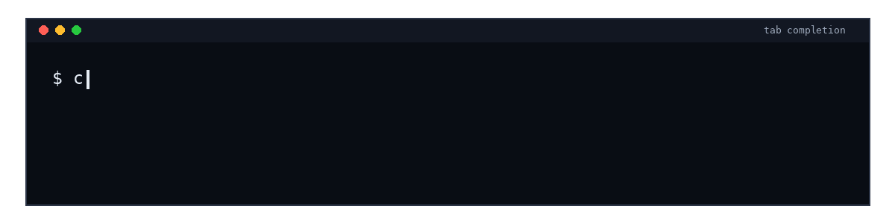

<!--
    SPDX-FileCopyrightText: Copyright 2026 Arm Limited and/or its affiliates <open-source-office@arm.com>

    SPDX-License-Identifier: Apache-2.0
-->

# Building and running Compute Flow bricks on Arm® CPUs

## Dependencies

- A native platform with macOS® or Linux® with an Arm®-based CPU.
- `uv`, used to create the Python environment.
- `git`, used by the Compute Flow brick manager.
- `adb`, only when deploying the Android™ build to a device.

Compute Flow downloads managed tools, such as CMake and the Android™ NDK, when a command needs them.

## Goal

This guide shows how to use the Compute Flow brick manager to install the Qwen3-TTS 0.6B Custom
Voice text-to-speech brick, inspect its model files and manifest, build Compute Flow for a native
Arm® CPU target, and run the Python and C++ CLI examples with a text prompt.

## Build and run on a native platform

Follow these steps from the Compute Flow project root on macOS® or Linux®.

### Step 1

Create and activate the Python environment:

```bash
uv sync
source .venv/bin/activate
```

Check that required system dependencies are available:

```bash
compute-flow check
```

If `compute-flow check` reports missing system dependencies, install them using the suggested action
and run `compute-flow check` again.

### Step 2

Update the local brick registry cache:

```bash
compute-flow update
```

List the models available for the Qwen3-TTS brick:

```bash
compute-flow model list tts:qwen3-tts
```

Shell completion can also show available brick and model names:



Install the Qwen3-TTS text-to-speech brick and its custom voice model:

```bash
compute-flow model install tts:qwen3-tts qwen3-tts-0-6b-custom-voice
```

### Step 3

Show the installed model details, including size and available manifests:

```bash
compute-flow model info tts:qwen3-tts qwen3-tts-0-6b-custom-voice
```

### Step 4

Build Compute Flow and the installed brick for the current machine:

```bash
compute-flow build native
```

On macOS® this builds for the Mac®. On a Raspberry Pi® this builds for the Pi.

### Step 5

The Python and C++ CLI examples use the same arguments. The `-p` argument supplies the text to
synthesize, `-o` selects the output WAV file, and `@manifest` selects a manifest from the installed
model package.

For Qwen3-TTS 0.6B Custom Voice in English, use `qwen3_tts_custom_voice_en_manifest.json`.

Run the Python CLI example:

```bash
python -m cli_examples.tts_cli \
  -m @manifest/qwen3-tts/qwen3-tts-0-6b-custom-voice/qwen3_tts_custom_voice_en_manifest.json \
  -p "Hello, I am Aiden, your personal AI assistant. How can I help?" \
  -t 1 \
  -o qwen3_tts_output.wav
```

Run the C++ CLI example:

```bash
./build_native/tts_cli \
  -m @manifest/qwen3-tts/qwen3-tts-0-6b-custom-voice/qwen3_tts_custom_voice_en_manifest.json \
  -p "Hello, I am Aiden, your personal AI assistant. How can I help?" \
  -t 1 \
  -o qwen3_tts_output.wav
```

## Build and run on Android™

### Step 1

Build Compute Flow for Android™:

```bash
compute-flow build android_arm64
```

### Step 2

The brick package directory contains the model files, tokenizer, and manifest used by the examples,
all of which need to be pushed to the device.

To get the path to the brick package, use:

```bash
PACKAGE_DIR="$(compute-flow model path tts:qwen3-tts qwen3-tts-0-6b-custom-voice)"
```

Now, you can push the C++ CLI binary and the model package to the device:

```bash
adb shell mkdir -p /data/local/tmp/compute-flow/qwen3-tts/brick_package
adb push build_android_arm64/tts_cli /data/local/tmp/compute-flow/qwen3-tts/
adb push "$PACKAGE_DIR"/* /data/local/tmp/compute-flow/qwen3-tts/brick_package/
```

The `brick_package` directory contains the files from the installed Qwen3-TTS 0.6B Custom Voice
model.

### Step 3

Run the C++ CLI example on the device from the same directory so the manifest can resolve the model
files:

```bash
adb shell
cd /data/local/tmp/compute-flow/qwen3-tts
./tts_cli \
  -m brick_package/qwen3_tts_custom_voice_en_manifest.json \
  -p "Hello, I am Aiden, your personal AI assistant. How can I help?" \
  -t 1 \
  -o qwen3_tts_output.wav
```
